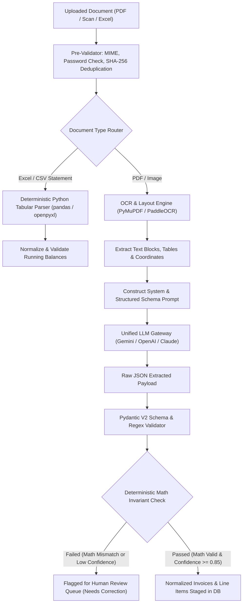

# AI & Document Intelligence Pipeline Specification
## AI-Powered Accounting Intelligence Platform

---

## 1. Pipeline Architectural Objectives
1. **Zero Hallucination Tolerance:** Language models must never fabricate GSTINs, invoice numbers, amounts, or line items.
2. **Provider Agnostic Abstraction:** Seamless switching between OpenAI (GPT-4o), Google (Gemini 1.5 Pro / Flash), Anthropic (Claude 3.5 Sonnet), and self-hosted models (via Ollama or vLLM).
3. **Deterministic Verification Gate:** Every LLM output passes through deterministic Pydantic schema validation and algebraic equality checks before reaching the database.

---

## 2. Ingestion & Extraction Workflow



---

## 3. Provider-Agnostic LLM Gateway

### Interface Definition
```python
from abc import ABC, abstractmethod
from pydantic import BaseModel, Field
from typing import List, Optional
from decimal import Decimal

class ExtractedLineItem(BaseModel):
    description: str
    hsn_sac: Optional[str] = None
    quantity: Optional[Decimal] = Decimal("1.0000")
    unit_price: Decimal
    taxable_amount: Decimal
    gst_rate_percent: Decimal
    cgst_amount: Decimal = Decimal("0.0000")
    sgst_amount: Decimal = Decimal("0.0000")
    igst_amount: Decimal = Decimal("0.0000")
    cess_amount: Decimal = Decimal("0.0000")
    confidence: float = Field(..., ge=0.0, le=1.0)

class ExtractedInvoiceSchema(BaseModel):
    invoice_type: str = Field(..., pattern="^(SALES|PURCHASE|EXPENSE)$")
    invoice_number: str
    invoice_date: str # YYYY-MM-DD
    due_date: Optional[str] = None
    supplier_name: str
    supplier_gstin: Optional[str] = None
    buyer_name: str
    buyer_gstin: Optional[str] = None
    place_of_supply_state_code: str = Field(..., min_length=2, max_length=2)
    taxable_subtotal: Decimal
    total_tax_amount: Decimal
    round_off_amount: Decimal = Decimal("0.0000")
    grand_total: Decimal
    currency: str = "INR"
    line_items: List[ExtractedLineItem]
    field_confidences: dict[str, float]

class DocumentExtractionProvider(ABC):
    @abstractmethod
    async def extract_invoice(self, document_text: str, document_image_base64: Optional[str] = None) -> ExtractedInvoiceSchema:
        """Extracts structured invoice data from OCR text and/or images."""
        pass
```

---

## 4. Prompt Engineering & System Constraints

### System Prompt Template
```markdown
You are an expert Indian Statutory Tax and Accounting AI specialized in extracting data from business invoices, receipts, and tax vouchers.

RULES:
1. Extract values exactly as printed. DO NOT infer, extrapolate, or invent missing values.
2. If a field (e.g., GSTIN or HSN) is absent, return null.
3. Validate that supplier_gstin matches regex: '^[0-9]{2}[A-Z]{5}[0-9]{4}[A-Z]{1}[1-9A-Z]{1}Z[0-9A-Z]{1}$'.
4. Identify Place of Supply (POS) 2-digit state code. If supplier and buyer are in the same state, tax must be CGST + SGST. If in different states, tax must be IGST.
5. Provide a confidence score between 0.00 and 1.00 for each extracted field.
6. Return output strictly in the requested JSON schema.
```

---

## 5. Deterministic Arithmetic Validation Layer

Even the most capable LLM can occasionally hallucinate a digit. The system applies **strict algebraic tests** in Python:

```python
def validate_invoice_arithmetic(invoice: ExtractedInvoiceSchema, tolerance: Decimal = Decimal("0.02")) -> bool:
    # 1. Line items sum vs Taxable Subtotal
    computed_taxable = sum(item.taxable_amount for item in invoice.line_items)
    if abs(computed_taxable - invoice.taxable_subtotal) > tolerance:
        return False
        
    # 2. Line items tax sum vs Total Tax
    computed_tax = sum(item.cgst_amount + item.sgst_amount + item.igst_amount + item.cess_amount for item in invoice.line_items)
    if abs(computed_tax - invoice.total_tax_amount) > tolerance:
        return False

    # 3. Subtotal + Tax + Roundoff vs Grand Total
    expected_grand_total = invoice.taxable_subtotal + invoice.total_tax_amount + invoice.round_off_amount
    if abs(expected_grand_total - invoice.grand_total) > tolerance:
        return False

    return True
```

If `validate_invoice_arithmetic()` returns `False`, the document is automatically set to `EXTRACTION_FAILED` or `REVIEW_PENDING`, preventing corrupt data from entering the reconciliation pipeline.
