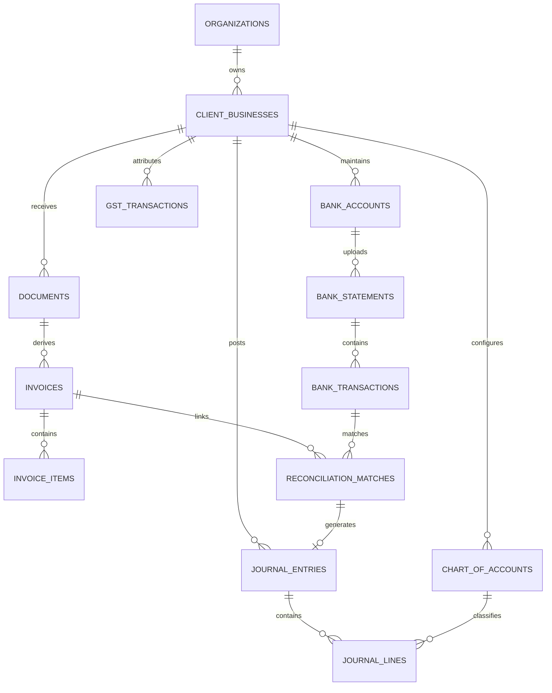

# Production Database Design & Schema Specification
## AI-Powered Accounting Intelligence Platform

---

## 1. Relational Design Principles
1. **Financial Precision:** All currency fields use `NUMERIC(18, 4)`. No floating-point data types.
2. **Tenant Isolation:** Every operational table carries `organization_id` (and `client_business_id` where applicable) as a foreign key with composite indexes.
3. **Immutability of Financial Records:** The `journal_entries` and `journal_lines` tables employ append-only semantics enforced by database triggers.
4. **Auditability:** Every table records `created_at`, `updated_at`, `created_by_user_id`, and `updated_by_user_id`.
5. **UUID Primary Keys:** All entities use UUID v4 (`UUID DEFAULT gen_random_uuid()`) to eliminate enumeration attacks and simplify distributed replication.

---

## 2. Entity Relationship Diagram (Core Modules)



---

## 3. Data Dictionary & Table Definitions

### 3.1 Organization & Identity

#### `organizations`
Represents the subscription and tenancy boundary (Freelancer or CA Firm).
```sql
CREATE TABLE organizations (
    id UUID PRIMARY KEY DEFAULT gen_random_uuid(),
    name VARCHAR(255) NOT NULL,
    organization_type VARCHAR(50) NOT NULL CHECK (organization_type IN ('FREELANCER', 'CA_FIRM', 'ENTERPRISE_PRACTICE')),
    primary_email VARCHAR(255) NOT NULL UNIQUE,
    phone VARCHAR(30),
    subscription_tier VARCHAR(50) NOT NULL DEFAULT 'FREE_TRIAL' CHECK (subscription_tier IN ('FREE_TRIAL', 'SILVER', 'GOLD', 'PLATINUM')),
    trial_ends_at TIMESTAMPTZ,
    is_active BOOLEAN NOT NULL DEFAULT TRUE,
    created_at TIMESTAMPTZ NOT NULL DEFAULT NOW(),
    updated_at TIMESTAMPTZ NOT NULL DEFAULT NOW()
);
CREATE INDEX idx_orgs_email ON organizations(primary_email);
```

#### `client_businesses`
Represents the accounting entity whose books are being managed.
```sql
CREATE TABLE client_businesses (
    id UUID PRIMARY KEY DEFAULT gen_random_uuid(),
    organization_id UUID NOT NULL REFERENCES organizations(id) ON DELETE RESTRICT,
    legal_name VARCHAR(255) NOT NULL,
    trade_name VARCHAR(255),
    entity_type VARCHAR(50) NOT NULL CHECK (entity_type IN ('INDIVIDUAL_FREELANCER', 'PROPRIETORSHIP', 'PARTNERSHIP', 'LLP', 'PVT_LTD')),
    pan VARCHAR(10) NOT NULL CHECK (pan ~ '^[A-Z]{5}[0-9]{4}[A-Z]{1}$'),
    primary_gstin VARCHAR(15) CHECK (primary_gstin ~ '^[0-9]{2}[A-Z]{5}[0-9]{4}[A-Z]{1}[1-9A-Z]{1}Z[0-9A-Z]{1}$'),
    gst_registered_state_code VARCHAR(2) NOT NULL,
    composition_scheme BOOLEAN NOT NULL DEFAULT FALSE,
    current_financial_year VARCHAR(9) NOT NULL DEFAULT '2024-2025',
    created_at TIMESTAMPTZ NOT NULL DEFAULT NOW(),
    updated_at TIMESTAMPTZ NOT NULL DEFAULT NOW(),
    CONSTRAINT uq_client_business_pan UNIQUE (organization_id, pan)
);
CREATE INDEX idx_client_biz_org ON client_businesses(organization_id);
```

---

### 3.2 Document Storage & AI Intelligence

#### `documents`
Original financial files ingested into the platform.
```sql
CREATE TABLE documents (
    id UUID PRIMARY KEY DEFAULT gen_random_uuid(),
    organization_id UUID NOT NULL REFERENCES organizations(id) ON DELETE RESTRICT,
    client_business_id UUID NOT NULL REFERENCES client_businesses(id) ON DELETE RESTRICT,
    file_name VARCHAR(255) NOT NULL,
    file_size_bytes BIGINT NOT NULL,
    mime_type VARCHAR(100) NOT NULL,
    s3_storage_key VARCHAR(512) NOT NULL UNIQUE,
    sha256_hash CHAR(64) NOT NULL,
    document_category VARCHAR(50) NOT NULL CHECK (document_category IN (
        'BANK_STATEMENT', 'SALES_INVOICE', 'PURCHASE_INVOICE', 'EXPENSE_RECEIPT',
        'CREDIT_NOTE', 'DEBIT_NOTE', 'PAYMENT_RECEIPT', 'OTHER'
    )),
    processing_status VARCHAR(50) NOT NULL DEFAULT 'UPLOADED' CHECK (processing_status IN (
        'UPLOADED', 'PROCESSING', 'EXTRACTION_FAILED', 'EXTRACTED', 'MATCHED',
        'REVIEW_PENDING', 'APPROVED', 'REJECTED', 'POSTED', 'SYNCED', 'SYNC_FAILED'
    )),
    extracted_metadata JSONB DEFAULT '{}'::jsonb,
    extraction_confidence NUMERIC(5, 4) DEFAULT 0.0000,
    is_duplicate BOOLEAN NOT NULL DEFAULT FALSE,
    created_at TIMESTAMPTZ NOT NULL DEFAULT NOW(),
    updated_at TIMESTAMPTZ NOT NULL DEFAULT NOW()
);
CREATE INDEX idx_docs_org_client ON documents(organization_id, client_business_id);
CREATE INDEX idx_docs_sha256 ON documents(organization_id, client_business_id, sha256_hash);
CREATE INDEX idx_docs_status ON documents(processing_status);
```

#### `invoices`
Normalized invoice records extracted by AI and reviewed by users.
```sql
CREATE TABLE invoices (
    id UUID PRIMARY KEY DEFAULT gen_random_uuid(),
    organization_id UUID NOT NULL REFERENCES organizations(id),
    client_business_id UUID NOT NULL REFERENCES client_businesses(id),
    document_id UUID NOT NULL REFERENCES documents(id) ON DELETE CASCADE,
    invoice_type VARCHAR(50) NOT NULL CHECK (invoice_type IN ('SALES', 'PURCHASE', 'EXPENSE')),
    invoice_number VARCHAR(100) NOT NULL,
    invoice_date DATE NOT NULL,
    due_date DATE,
    counterparty_name VARCHAR(255) NOT NULL,
    counterparty_gstin VARCHAR(15),
    counterparty_state_code VARCHAR(2),
    place_of_supply_state_code VARCHAR(2) NOT NULL,
    taxable_amount NUMERIC(18, 4) NOT NULL DEFAULT 0.0000,
    cgst_amount NUMERIC(18, 4) NOT NULL DEFAULT 0.0000,
    sgst_amount NUMERIC(18, 4) NOT NULL DEFAULT 0.0000,
    igst_amount NUMERIC(18, 4) NOT NULL DEFAULT 0.0000,
    cess_amount NUMERIC(18, 4) NOT NULL DEFAULT 0.0000,
    round_off_amount NUMERIC(18, 4) NOT NULL DEFAULT 0.0000,
    total_amount NUMERIC(18, 4) NOT NULL,
    balance_due_amount NUMERIC(18, 4) NOT NULL,
    currency VARCHAR(3) NOT NULL DEFAULT 'INR',
    itc_eligibility VARCHAR(50) NOT NULL DEFAULT 'PENDING' CHECK (itc_eligibility IN (
        'ELIGIBLE_INPUT_SERVICES', 'ELIGIBLE_INPUT_GOODS', 'ELIGIBLE_CAPITAL_GOODS',
        'INELIGIBLE_SEC_17_5', 'NOT_APPLICABLE', 'PENDING'
    )),
    is_reverse_charge BOOLEAN NOT NULL DEFAULT FALSE,
    is_export_lut BOOLEAN NOT NULL DEFAULT FALSE,
    lut_number VARCHAR(50),
    approval_status VARCHAR(50) NOT NULL DEFAULT 'PENDING' CHECK (approval_status IN ('PENDING', 'APPROVED', 'REJECTED')),
    created_at TIMESTAMPTZ NOT NULL DEFAULT NOW(),
    updated_at TIMESTAMPTZ NOT NULL DEFAULT NOW(),
    CONSTRAINT uq_invoice_number UNIQUE (client_business_id, counterparty_gstin, invoice_number)
);
CREATE INDEX idx_invoices_biz_date ON invoices(client_business_id, invoice_date);
CREATE INDEX idx_invoices_due ON invoices(client_business_id, balance_due_amount) WHERE balance_due_amount > 0;
```

---

### 3.3 Banking & Transactions

#### `bank_accounts`
```sql
CREATE TABLE bank_accounts (
    id UUID PRIMARY KEY DEFAULT gen_random_uuid(),
    organization_id UUID NOT NULL REFERENCES organizations(id),
    client_business_id UUID NOT NULL REFERENCES client_businesses(id),
    account_name VARCHAR(100) NOT NULL,
    account_number VARCHAR(50) NOT NULL,
    ifsc_code VARCHAR(11) NOT NULL,
    bank_name VARCHAR(100) NOT NULL,
    account_type VARCHAR(50) NOT NULL CHECK (account_type IN ('CURRENT', 'SAVINGS', 'OVERDRAFT', 'CREDIT_CARD')),
    currency VARCHAR(3) NOT NULL DEFAULT 'INR',
    opening_balance NUMERIC(18, 4) NOT NULL DEFAULT 0.0000,
    opening_balance_date DATE NOT NULL,
    current_ledger_balance NUMERIC(18, 4) NOT NULL DEFAULT 0.0000,
    is_active BOOLEAN NOT NULL DEFAULT TRUE,
    created_at TIMESTAMPTZ NOT NULL DEFAULT NOW(),
    updated_at TIMESTAMPTZ NOT NULL DEFAULT NOW(),
    CONSTRAINT uq_bank_acc UNIQUE (client_business_id, account_number, ifsc_code)
);
```

#### `bank_transactions`
```sql
CREATE TABLE bank_transactions (
    id UUID PRIMARY KEY DEFAULT gen_random_uuid(),
    organization_id UUID NOT NULL REFERENCES organizations(id),
    client_business_id UUID NOT NULL REFERENCES client_businesses(id),
    bank_account_id UUID NOT NULL REFERENCES bank_accounts(id),
    document_id UUID REFERENCES documents(id),
    transaction_date DATE NOT NULL,
    value_date DATE,
    narration TEXT NOT NULL,
    reference_number VARCHAR(100),
    utr_number VARCHAR(100),
    cheque_number VARCHAR(20),
    transaction_type VARCHAR(10) NOT NULL CHECK (transaction_type IN ('DEBIT', 'CREDIT')),
    amount NUMERIC(18, 4) NOT NULL,
    running_balance NUMERIC(18, 4) NOT NULL,
    classification_category VARCHAR(50) NOT NULL DEFAULT 'UNCLASSIFIED' CHECK (classification_category IN (
        'OPERATING_REVENUE', 'OPERATING_EXPENSE', 'INTERNAL_CONTRA', 'CAPITAL_INJECTION',
        'OWNER_DRAWINGS', 'TAX_PAYMENT_GST', 'TAX_PAYMENT_ADVANCE_TAX', 'BANK_CHARGES',
        'INTEREST_INCOME', 'LOAN_DISBURSEMENT_REPAYMENT', 'UNCLASSIFIED'
    )),
    reconciliation_status VARCHAR(50) NOT NULL DEFAULT 'UNRECONCILED' CHECK (reconciliation_status IN (
        'UNRECONCILED', 'PARTIALLY_RECONCILED', 'FULLY_RECONCILED', 'EXCLUDED'
    )),
    unreconciled_amount NUMERIC(18, 4) NOT NULL,
    created_at TIMESTAMPTZ NOT NULL DEFAULT NOW(),
    updated_at TIMESTAMPTZ NOT NULL DEFAULT NOW()
);
CREATE INDEX idx_bank_txns_recon ON bank_transactions(client_business_id, reconciliation_status);
CREATE INDEX idx_bank_txns_utr ON bank_transactions(utr_number) WHERE utr_number IS NOT NULL;
CREATE INDEX idx_bank_txns_date ON bank_transactions(client_business_id, transaction_date);
```

---

### 3.4 Reconciliation & Matching

#### `reconciliation_matches`
Links one or more bank transactions to one or more invoices or tax payments.
```sql
CREATE TABLE reconciliation_matches (
    id UUID PRIMARY KEY DEFAULT gen_random_uuid(),
    organization_id UUID NOT NULL REFERENCES organizations(id),
    client_business_id UUID NOT NULL REFERENCES client_businesses(id),
    bank_transaction_id UUID NOT NULL REFERENCES bank_transactions(id),
    invoice_id UUID REFERENCES invoices(id),
    match_scenario VARCHAR(50) NOT NULL CHECK (match_scenario IN (
        'EXACT_ONE_TO_ONE', 'ONE_TO_MANY_INVOICES', 'MANY_TRANSACTIONS_ONE_INVOICE',
        'PARTIAL_PAYMENT', 'ADVANCE_PAYMENT', 'TDS_ADJUSTED_SETTLEMENT', 'CONTRA_TRANSFER',
        'MANUAL_ALLOCATION'
    )),
    allocated_amount NUMERIC(18, 4) NOT NULL,
    tds_deducted_amount NUMERIC(18, 4) NOT NULL DEFAULT 0.0000,
    tds_section VARCHAR(20) CHECK (tds_section IN ('194C', '194J_TECH', '194J_PROF', '194Q', 'NONE')),
    confidence_score NUMERIC(5, 4) NOT NULL,
    match_rationale TEXT NOT NULL,
    approval_status VARCHAR(50) NOT NULL DEFAULT 'PENDING' CHECK (approval_status IN (
        'PENDING', 'APPROVED', 'REJECTED'
    )),
    approved_by_user_id UUID,
    approved_at TIMESTAMPTZ,
    rejection_reason TEXT,
    journal_entry_id UUID,
    created_at TIMESTAMPTZ NOT NULL DEFAULT NOW(),
    updated_at TIMESTAMPTZ NOT NULL DEFAULT NOW()
);
CREATE INDEX idx_recon_match_tx ON reconciliation_matches(bank_transaction_id);
CREATE INDEX idx_recon_match_inv ON reconciliation_matches(invoice_id);
```

---

### 3.5 Core Double-Entry Ledger (Immutable)

#### `chart_of_accounts`
```sql
CREATE TABLE chart_of_accounts (
    id UUID PRIMARY KEY DEFAULT gen_random_uuid(),
    organization_id UUID NOT NULL REFERENCES organizations(id),
    client_business_id UUID NOT NULL REFERENCES client_businesses(id),
    account_code VARCHAR(20) NOT NULL,
    account_name VARCHAR(150) NOT NULL,
    account_type VARCHAR(50) NOT NULL CHECK (account_type IN ('ASSET', 'LIABILITY', 'EQUITY', 'INCOME', 'EXPENSE')),
    parent_account_id UUID REFERENCES chart_of_accounts(id),
    is_reconciliation_account BOOLEAN NOT NULL DEFAULT FALSE,
    is_system_reserved BOOLEAN NOT NULL DEFAULT FALSE,
    tally_ledger_name VARCHAR(200),
    zoho_account_id VARCHAR(100),
    is_active BOOLEAN NOT NULL DEFAULT TRUE,
    created_at TIMESTAMPTZ NOT NULL DEFAULT NOW(),
    updated_at TIMESTAMPTZ NOT NULL DEFAULT NOW(),
    CONSTRAINT uq_coa_code UNIQUE (client_business_id, account_code)
);
```

#### `journal_entries` & `journal_lines`
```sql
CREATE TABLE journal_entries (
    id UUID PRIMARY KEY DEFAULT gen_random_uuid(),
    organization_id UUID NOT NULL REFERENCES organizations(id),
    client_business_id UUID NOT NULL REFERENCES client_businesses(id),
    entry_number VARCHAR(50) NOT NULL,
    posting_date DATE NOT NULL,
    financial_year VARCHAR(9) NOT NULL,
    voucher_type VARCHAR(50) NOT NULL CHECK (voucher_type IN (
        'SALES_INVOICE', 'PURCHASE_BILL', 'PAYMENT', 'RECEIPT', 'CONTRA', 'JOURNAL_ADJUSTMENT', 'REVERSAL'
    )),
    narration TEXT NOT NULL,
    source_document_id UUID REFERENCES documents(id),
    reconciliation_match_id UUID REFERENCES reconciliation_matches(id),
    is_posted BOOLEAN NOT NULL DEFAULT FALSE,
    is_reversal BOOLEAN NOT NULL DEFAULT FALSE,
    reversal_of_entry_id UUID REFERENCES journal_entries(id),
    posted_by_user_id UUID,
    posted_at TIMESTAMPTZ,
    sync_status VARCHAR(50) NOT NULL DEFAULT 'NOT_SYNCED' CHECK (sync_status IN (
        'NOT_SYNCED', 'SYNC_PENDING', 'SYNCED_TALLY', 'SYNCED_ZOHO', 'SYNC_FAILED'
    )),
    created_at TIMESTAMPTZ NOT NULL DEFAULT NOW(),
    updated_at TIMESTAMPTZ NOT NULL DEFAULT NOW(),
    CONSTRAINT uq_entry_number UNIQUE (client_business_id, financial_year, entry_number)
);

CREATE TABLE journal_lines (
    id UUID PRIMARY KEY DEFAULT gen_random_uuid(),
    journal_entry_id UUID NOT NULL REFERENCES journal_entries(id) ON DELETE CASCADE,
    account_id UUID NOT NULL REFERENCES chart_of_accounts(id),
    line_number INT NOT NULL,
    entry_side VARCHAR(2) NOT NULL CHECK (entry_side IN ('DR', 'CR')),
    amount NUMERIC(18, 4) NOT NULL CHECK (amount > 0),
    description VARCHAR(255),
    created_at TIMESTAMPTZ NOT NULL DEFAULT NOW(),
    CONSTRAINT uq_journal_line UNIQUE (journal_entry_id, line_number)
);
CREATE INDEX idx_jlines_account ON journal_lines(account_id);
```

#### Invariant Trigger for Double-Entry Balance
```sql
-- Trigger to verify sum of debits == sum of credits before marking entry is_posted = TRUE
CREATE OR REPLACE FUNCTION verify_journal_entry_balanced()
RETURNS TRIGGER AS $$
DECLARE
    sum_dr NUMERIC(18, 4);
    sum_cr NUMERIC(18, 4);
BEGIN
    IF NEW.is_posted = TRUE AND OLD.is_posted = FALSE THEN
        SELECT COALESCE(SUM(amount), 0) INTO sum_dr FROM journal_lines WHERE journal_entry_id = NEW.id AND entry_side = 'DR';
        SELECT COALESCE(SUM(amount), 0) INTO sum_cr FROM journal_lines WHERE journal_entry_id = NEW.id AND entry_side = 'CR';
        
        IF sum_dr = 0 OR sum_cr = 0 OR sum_dr <> sum_cr THEN
            RAISE EXCEPTION 'Accounting Invariant Violation: Journal Entry % is not balanced! Total Debits: %, Total Credits: %', NEW.id, sum_dr, sum_cr;
        END IF;
    END IF;
    RETURN NEW;
END;
$$ LANGUAGE plpgsql;

CREATE TRIGGER trg_verify_journal_balance
BEFORE UPDATE ON journal_entries
FOR EACH ROW
EXECUTE FUNCTION verify_journal_entry_balanced();
```
