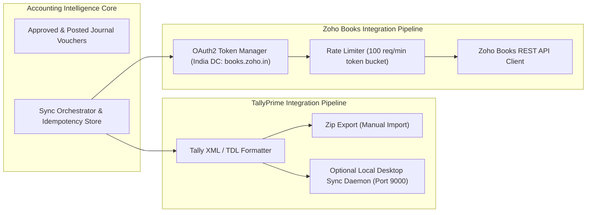

# Integration Architecture Specification
## TallyPrime, Zoho Books & Banking Data Adapters

---

## 1. External Integration Overview
The platform acts as a bridge between raw unstructured business artifacts and structured accounting systems. The integration architecture provides decoupled, idempotent, and recoverable synchronization adapters.



---

## 2. TallyPrime Integration Specification

### 2.1 Interface Strategy
1. **Batch XML Voucher Export (Default & Universally Compatible):**
   - Generates TDL-compliant XML import files that users can import into any TallyPrime edition (Silver, Gold, Server) via `Import Data -> Vouchers`.
   - Guaranteed compatibility with TallyPrime 1.x, 2.x, 3.x, and 4.x.
2. **Direct Local Sync Agent (Optional):**
   - For CA firms desiring direct push, a lightweight Python/Go desktop daemon connects to the local Tally XML port (`http://localhost:9000`).

### 2.2 Tally XML Voucher Structure Example (Receipt with TDS)
```xml
<ENVELOPE>
  <HEADER>
    <TALLYREQUEST>Import Data</TALLYREQUEST>
  </HEADER>
  <BODY>
    <IMPORTDATA>
      <REQUESTDESC>
        <REPORTNAME>Vouchers</REPORTNAME>
        <STATICVARIABLES>
          <SVCURRENTCOMPANY>Acme Technologies LLP</SVCURRENTCOMPANY>
        </STATICVARIABLES>
      </REQUESTDESC>
      <REQUESTDATA>
        <TALLYMESSAGE xmlns:UDF="TallyUDF">
          <VOUCHER VCHTYPE="Receipt" ACTION="Create" OBJVIEW="Accounting Voucher View">
            <DATE>20241025</DATE>
            <VOUCHERTYPENAME>Receipt</VOUCHERTYPENAME>
            <VOUCHERNUMBER>REC-2024-001</VOUCHERNUMBER>
            <REFERENCE>N298310</REFERENCE>
            <NARRATION>Payment received against INV-2024-089 after 10% TDS deduction Sec 194J</NARRATION>
            <!-- Bank Debit -->
            <ALLLEDGERENTRIES.LIST>
              <LEDGERNAME>HDFC Bank Current A/c</LEDGERNAME>
              <ISDEEMEDPOSITIVE>Yes</ISDEEMEDPOSITIVE>
              <AMOUNT>-108000.00</AMOUNT>
            </ALLLEDGERENTRIES.LIST>
            <!-- TDS Receivable Debit -->
            <ALLLEDGERENTRIES.LIST>
              <LEDGERNAME>TDS Receivable (Sec 194J)</LEDGERNAME>
              <ISDEEMEDPOSITIVE>Yes</ISDEEMEDPOSITIVE>
              <AMOUNT>-10000.00</AMOUNT>
            </ALLLEDGERENTRIES.LIST>
            <!-- Customer Credit -->
            <ALLLEDGERENTRIES.LIST>
              <LEDGERNAME>Infosys BPM Limited</LEDGERNAME>
              <ISDEEMEDPOSITIVE>No</ISDEEMEDPOSITIVE>
              <AMOUNT>118000.00</AMOUNT>
            </ALLLEDGERENTRIES.LIST>
          </VOUCHER>
        </TALLYMESSAGE>
      </REQUESTDATA>
    </IMPORTDATA>
  </BODY>
</ENVELOPE>
```

---

## 3. Zoho Books Integration Specification

### 3.1 OAuth2 Flow & India Data Center Configuration
- **Auth URL:** `https://accounts.zoho.in/oauth/v2/auth`
- **Token URL:** `https://accounts.zoho.in/oauth/v2/token`
- **Base API URL:** `https://www.zohoapis.in/books/v3`
- **Scopes Required:**
  - `ZohoBooks.settings.READ`
  - `ZohoBooks.contacts.READ`, `ZohoBooks.contacts.CREATE`
  - `ZohoBooks.invoices.READ`, `ZohoBooks.invoices.CREATE`
  - `ZohoBooks.bills.READ`, `ZohoBooks.bills.CREATE`
  - `ZohoBooks.banking.READ`, `ZohoBooks.banking.CREATE`

### 3.2 Idempotency & Duplicate Prevention
Zoho Books API accepts an `X-Unique-Identifier` or custom reference field.
- For each voucher synchronized, the internal `journal_entries.id` (UUID) is sent in the `reference_number` or custom field `cf_intelligence_voucher_id`.
- Before syncing, the adapter queries Zoho Books:
  `GET /invoices?reference_number={entry_id}`
- If a record with this reference exists, the sync job records status as `ALREADY_SYNCED` and updates the internal mapping table without duplicating records.

---

## 4. Bank Statement Parser Specifications

| Bank | Statement Formats | Unique Characteristics & Parsing Logic |
|---|---|---|
| **HDFC Bank** | PDF, Excel, CSV | Running balance in column 7. Narration contains `N<ref>` for NEFT or `UPI/<ref>/<payee>`. |
| **ICICI Bank** | PDF, Excel | Password standard: First 4 characters of name in lowercase + DDMM. Table spans across pages with repeating headers. |
| **State Bank of India (SBI)** | PDF, XLS | Distinct "Txn Date" vs "Value Date". Narrations often contain `TRANSFER TO...` or `BY TRANSFER...`. |
| **Axis Bank** | PDF, CSV | Two header rows. Cleared cheques include 6-digit cheque number in separate column. |
| **Kotak Mahindra Bank** | PDF, Excel | Clear UTR references in NEFT/RTGS narrations. |

### Statement Normalization Rule
All parsers output a canonical Python Pydantic structure:
```python
class CanonicalBankTxn(BaseModel):
    transaction_date: date
    value_date: Optional[date]
    narration: str
    reference_number: Optional[str]
    utr_number: Optional[str]
    cheque_number: Optional[str]
    is_credit: bool # True for Credit (Inflow), False for Debit (Outflow)
    amount: Decimal # Always positive Decimal
    running_balance: Decimal
```
This ensures downstream reconciliation logic is 100% bank-agnostic.
