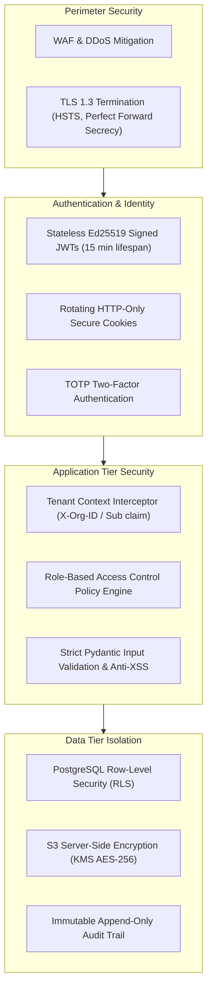

# Security Architecture & Tenant Isolation Specification
## AI-Powered Accounting Intelligence Platform

---

## 1. Threat Model & Security Posture
Financial records, bank transactions, and customer invoices are confidential statutory assets. The platform adheres to **Zero Trust Architecture** and **Defense in Depth** across network, application, data, and storage tiers.



---

## 2. Multi-Tenant Isolation: Row-Level Security (RLS)

To prevent data leakage in a multi-client CA firm environment, PostgreSQL Row-Level Security (RLS) is enforced at the database engine level. Even if an application bug omits a `WHERE organization_id = :org_id` clause, the database will refuse to return rows belonging to other tenants.

```sql
-- Enable RLS on core financial tables
ALTER TABLE documents ENABLE ROW LEVEL SECURITY;
ALTER TABLE invoices ENABLE ROW LEVEL SECURITY;
ALTER TABLE bank_transactions ENABLE ROW LEVEL SECURITY;
ALTER TABLE journal_entries ENABLE ROW LEVEL SECURITY;
ALTER TABLE journal_lines ENABLE ROW LEVEL SECURITY;

-- Create policy based on session variable
CREATE POLICY tenant_isolation_policy ON invoices
    FOR ALL
    USING (organization_id = NULLIF(current_setting('app.current_org_id', true), '')::uuid);
```

During each API request lifecycle, the FastAPI middleware sets this context:
```python
async def set_tenant_db_context(db_session: AsyncSession, org_id: str):
    await db_session.execute(
        text("SET LOCAL app.current_org_id = :org_id"),
        {"org_id": org_id}
    )
```

---

## 3. Role-Based Access Control (RBAC) Matrix

| Permission Key | Freelancer Owner | CA Firm Partner | Staff Accountant | Client Read-Only |
|---|:---:|:---:|:---:|:---:|
| `doc:upload` | ✅ | ✅ | ✅ | ✅ |
| `doc:view` | ✅ | ✅ | ✅ | ✅ |
| `doc:override_extracted` | ✅ | ✅ | ✅ | ❌ |
| `recon:view_candidates` | ✅ | ✅ | ✅ | ❌ |
| `recon:approve_and_post` | ✅ | ✅ | ❌ (Review only)| ❌ |
| `accounting:view_reports` | ✅ | ✅ | ✅ | ✅ (Own books) |
| `accounting:period_lock` | ✅ | ✅ | ❌ | ❌ |
| `sync:tally_zoho` | ✅ | ✅ | ❌ | ❌ |
| `admin:manage_users` | ✅ | ✅ | ❌ | ❌ |

---

## 4. Document & Object Storage Security
1. **Malware & MIME Verification:** Every uploaded file undergoes file signature (magic byte) verification and virus scanning (ClamAV in async pipeline).
2. **Server-Side Encryption:** S3 buckets use AWS KMS or customer-managed keys with `AES-256`.
3. **Pre-Signed URLs:** Documents are never served publicly. The frontend accesses files via time-bounded (15-minute) pre-signed URLs generated strictly for authenticated users with tenant access.
4. **Password-Protected Statements:** Bank statement passwords provided by users are processed in-memory during extraction and are **never persisted to disk or databases in plaintext**.

---

## 5. Immutable Audit Trail Specification

Every state modification emits an immutable event into `audit_events`:

```sql
CREATE TABLE audit_events (
    id UUID PRIMARY KEY DEFAULT gen_random_uuid(),
    organization_id UUID NOT NULL,
    actor_user_id UUID NOT NULL,
    actor_ip_address VARCHAR(45) NOT NULL,
    user_agent TEXT,
    event_type VARCHAR(100) NOT NULL, -- e.g. 'MATCH_APPROVED', 'FIELD_OVERRIDDEN', 'VOUCHER_POSTED'
    target_entity_type VARCHAR(50) NOT NULL, -- e.g. 'INVOICE', 'JOURNAL_ENTRY'
    target_entity_id UUID NOT NULL,
    previous_state JSONB,
    new_state JSONB,
    created_at TIMESTAMPTZ NOT NULL DEFAULT NOW()
);
CREATE INDEX idx_audit_org_time ON audit_events(organization_id, created_at DESC);
CREATE INDEX idx_audit_target ON audit_events(target_entity_type, target_entity_id);
```
Once written, the `audit_events` table cannot be updated or deleted (`REVOKE UPDATE, DELETE ON audit_events FROM ALL`).
