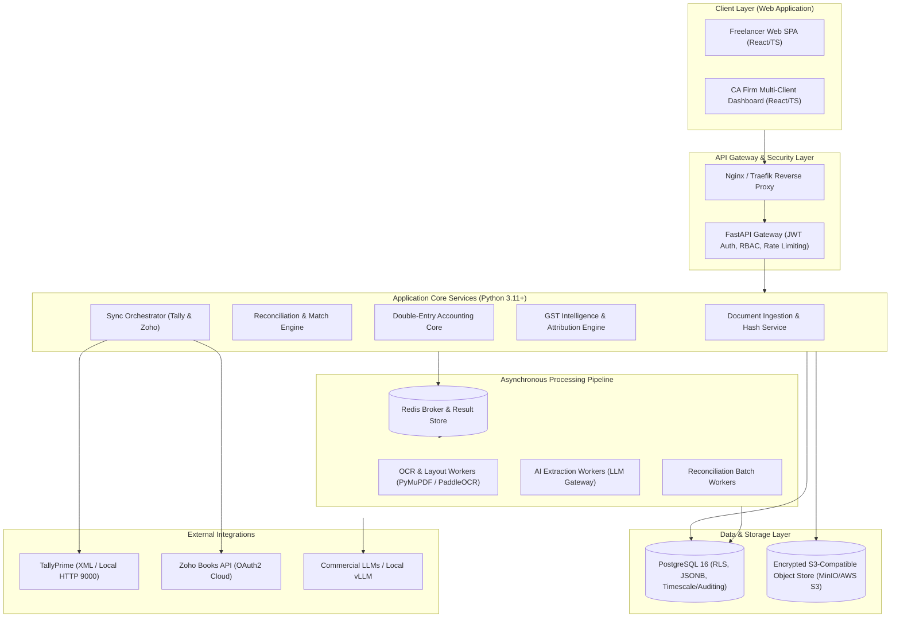
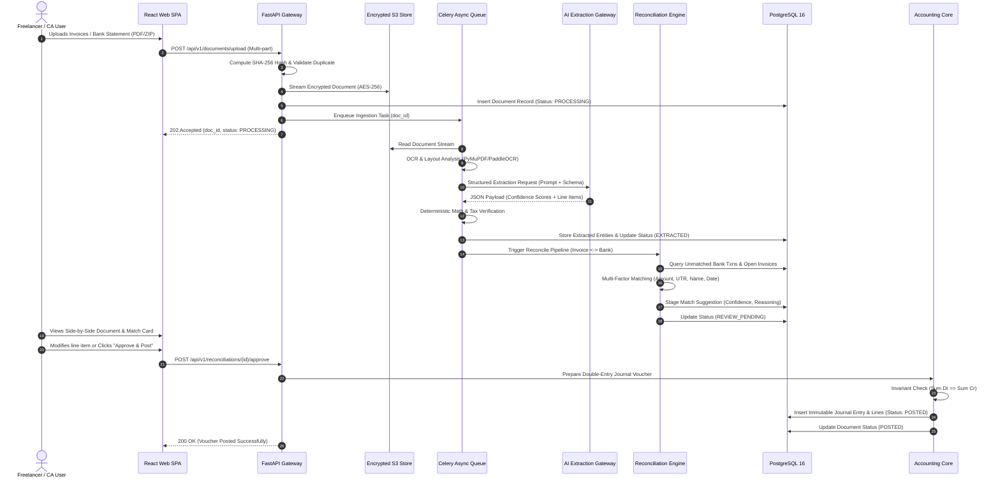
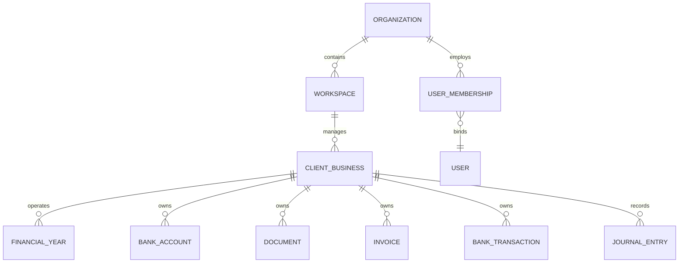

# System Architecture Specification
## AI-Powered Accounting Intelligence Platform

---

## 1. Architectural Philosophy & Overview
The platform follows a **Clean Hexagonal Architecture (Ports and Adapters)** combined with an **Asynchronous Event-Driven Ingestion Pipeline**. This ensures the core double-entry accounting engine and GST rules remain completely isolated from database technologies, UI frameworks, OCR tools, and commercial AI providers.

---

## 2. High-Level Component Decomposition

### 2.1 Web Frontend (React + TypeScript + Tailwind CSS)
- **Architecture:** Modular SPA built with Vite, React 18+, TypeScript, Zustand (lightweight client state), TanStack Query (server state & caching), and Tailwind CSS for a minimal, dense, high-efficiency accounting UI.
- **Sub-Applications:**
  1. *Freelancer Portal:* Focused on rapid bank statement upload, expense categorization, net tax payable, and simple P&L.
  2. *CA Firm Console:* Multi-client workspace switcher, high-density transaction tables, split-screen PDF verification viewer, bulk approval actions, and GSTR-2B reconciliation grids.

### 2.2 FastAPI Backend Application
- **Async Asynchronous I/O:** High concurrency handling of upload streams and real-time reconciliation event streams (SSE).
- **Pydantic V2 Validation:** Compile-time and runtime type safety; guarantees decimal precision serialization.
- **Dependency Injection:** Pluggable repositories, authentication contexts, and unit-of-work transactions.

### 2.3 Asynchronous Execution Tier (Celery + Redis)
- **Task Decoupling:** Long-running OCR parsing, document embedding, and multi-invoice fuzzy matching are decoupled from user HTTP request cycles.
- **Task Queues:**
  - `ocr_queue`: CPU-intensive PDF rendering and text/table extraction.
  - `llm_extraction_queue`: Rate-limited external LLM API calls with backoff.
  - `reconciliation_queue`: Heavy multi-way combinatorial matching.
  - `sync_queue`: Network I/O for Zoho Books API and Tally export generation.

---

## 3. End-to-End Document Ingestion & Posting Flow

The diagram below maps the end-to-end journey of an invoice or bank statement:

---

## 4. Multi-Tenant Organization Data Hierarchy

- **Top-Level Tenant (`ORGANIZATION`):** The legal billing entity (either an independent Freelancer or a CA Practice Firm).
- **Workspace (`WORKSPACE`):** Sub-partition (e.g., "Direct Freelance Practice", "Audit Division", "SME Retainer Clients").
- **Client Business (`CLIENT_BUSINESS`):** The actual accounting subject (has its own GSTIN, PAN, Financial Years, and Chart of Accounts). For freelancers, the organization and client business have a 1:1 relationship. For CA firms, 1 workspace has $N$ client businesses.
- **Tenant Context Enforcement:** Every query filters by `organization_id` and `client_business_id`, preventing cross-client or cross-firm data exposure.
